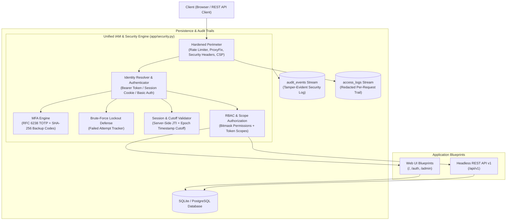
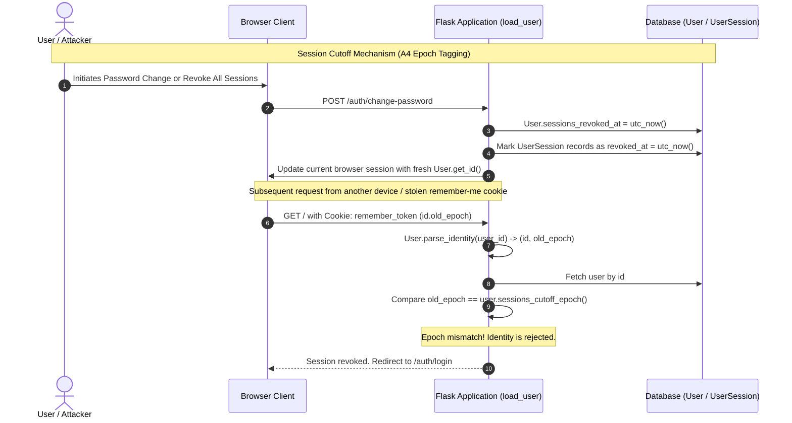

# Blogg

A full-featured, production-ready blogging and social networking web application built with **Flask 3.1**, **SQLAlchemy 2.0**, and managed with **uv**.

Blogg features a native, enterprise-grade **Identity and Access Management (IAM)** and security layer with zero external identity provider dependencies. It provides multi-factor authentication (TOTP + hashed backup codes), dual-layer server-side session tracking with epoch-based revocation cutoffs, granular role-based access control (RBAC), self-auditing security streams, per-request access trails with path-token redaction, opaque scoped API tokens, brute-force account lockout, password lifecycle management (history, expiry, forced resets), and privacy-preserving account tombstoning.

---

## Architecture Overview



---

## Core Features

### 1. Identity & Access Management (IAM)
- **Multi-Factor Authentication (TOTP)**: RFC 6238 TOTP enrollment via in-memory QR codes, single-use SHA-256 hashed backup codes, and rate-limited backup code regeneration. Supported across both web UI and headless REST API (`X-MFA-OTP`).
- **Dual-Layer Session Management & Epoch Cutoff**: Server-side session tracking via UUID `jti` cookies paired with a per-user `sessions_revoked_at` epoch cutoff in `User.get_id()`. Invalidates remembered browsers and active sessions across all devices instantly on password changes or global revocations.
- **Account Lockout & Brute-Force Defense**: Automatic lockout after exceeding consecutive failure thresholds (`BLOGG_MAX_FAILED_LOGINS`) with uniform error messaging preventing user enumeration. Lockout counter resets only after full two-factor completion.
- **Password Policy & Account Lifecycle**:
  - Configurable password history depth (`BLOGG_PASSWORD_HISTORY_COUNT`) preventing reuse.
  - Admin-enforced password changes (`must_change_password`) and opt-in password expiration (`BLOGG_PASSWORD_MAX_AGE_DAYS`).
  - Single-use, timestamp-signed reset tokens cryptographically bound to a SHA-256 password hash fingerprint (invalidated immediately upon password change).
  - Privacy-preserving account tombstoning (`user.anonymize()`): strips credentials, MFA secrets, and sessions while preserving authored discussions under an anonymous `deleted_<id>` identifier.
- **Granular Role-Based Access Control (RBAC)**:
  - 7-bitmask permission flags: `FOLLOW`, `COMMENT`, `WRITE`, `MODERATE`, `ADMIN`, `MANAGE_USERS`, `VIEW_AUDIT`.
  - Built-in roles (`User`, `Moderator`, `Administrator`) plus custom dynamic roles.
  - Hardened administrative guardrails: last-active-admin protection, non-deletable built-in roles, and privilege-escalation prevention.
- **Dual Audit & Access Trails**:
  - `audit_events`: Tamper-evident structured trail of all security-critical operations with IP and User-Agent capture.
  - `access_logs`: Request-level access monitoring with automatic redaction of embedded single-use tokens and exclusion of query parameters.
  - Self-auditing: Viewing or exporting logs triggers audit events; built-in automated log retention pruning (`flask prune-logs`).
- **Opaque Scoped API Tokens**: 64-hex entropy tokens hashed with SHA-256 at rest, bound to TTL limits and granular capability scopes (`profile:read`, `posts:read`, `posts:write`, `comments:write`, `tokens:manage`, `admin`).

### 2. Modern Blogging & Social Network
- **Markdown Publishing**: Full Markdown editing with Flask-PageDown live preview and server-side Bleach HTML sanitization against XSS.
- **Dynamic Reading Time**: Automatic reading time estimation calculation on every post.
- **Social Graph**: Interactive post likes (AJAX-supported), bidirectional follow/unfollow system, and custom activity timelines.
- **Moderation Dashboard**: Dedicated moderation interface for comment reviews, approvals, and inline hide/unhide toggling.
- **Theme & Profiles**: Inter-based responsive UI with persisted Dark/Light mode theme switching, Gravatar avatars, and `last_seen` telemetry.
- **Headless REST API (v1)**: Full JSON REST interface matching browser capabilities.

---

## Security & IAM Architecture Deep Dive

### 1. Multi-Factor Authentication (MFA / 2FA)
Blogg provides native RFC 6238 Time-based One-Time Password (TOTP) authentication using `pyotp`:
- **Enrollment Flow (`/auth/security/mfa/setup`)**: Generates a cryptographically random Base32 secret. The provisioning URI is rendered in-memory as an inline base64 PNG data URI (`qrcode`), ensuring no QR codes or secret keys touch the server filesystem.
- **Single-Use Backup Codes**: Generates 10 8-character recovery codes (`xxxx-xxxx`). To prevent credential exposure at rest, only their SHA-256 digests are stored in `User.mfa_backup_codes`. Once consumed, a backup code is atomically removed from the set.
- **Backup Code Regeneration**: Users can regenerate their backup codes at any time via `POST /auth/security/mfa/backup-codes` (rate-limited to 10 per hour), immediately invalidating the previous set.
- **Atomic Lockout Counter Reset**: The failure counter is only cleared after a user successfully completes *both* factors (password and OTP/backup code). This prevents brute-force OTP guessing while ensuring users with prior mistyped passwords do not suffer unexpected lockouts.
- **Headless API 2FA**: REST API clients supply their current 6-digit code via the `X-MFA-OTP` HTTP header or as an `otp` field in the JSON body of `POST /api/v1/tokens`.

### 2. Brute-Force Protection & Account Lockout
- **Lockout Policy**: After `BLOGG_MAX_FAILED_LOGINS` (default: `5`) consecutive failed authentication attempts, the account is locked for `BLOGG_LOCKOUT_MINUTES` (default: `15`).
- **Uniform Policy Across Interfaces**: `authenticate_credentials()` in `app/security.py` enforces identical lockout rules across browser logins and REST API Basic authentication.
- **Anti-Enumeration Defense**: Authentication failures return identical responses ("Invalid username or password" in web UI; `401 {"error": "unauthorized", "message": "Invalid email or password."}` in the API) whether the account exists, has a wrong password, or is unconfirmed.
- **Administrative Remediation**: Administrators can manually unlock accounts directly via `/admin/users/<id>` or `PATCH /api/v1/admin/users/<id>`.

### 3. Dual-Layer Session Management & Epoch Cutoff Revocation
Session management combines stateful database records with stateless Flask-Login remember cookies:



- **Server-Side Session Tracking (`UserSession`)**: Each authenticated login issues a UUID `jti` stored in the session cookie. The database stores device IP, user agent, `created_at`, `last_seen_at`, and `expires_at`. Enforces idle timeouts (`BLOGG_SESSION_IDLE_MINUTES`) and absolute timeouts (`BLOGG_SESSION_ABSOLUTE_HOURS`).
- **Stateless Remember-Me Revocation (Epoch Cutoff)**: Flask-Login remember cookies are signed tokens. Under typical implementations, revoking database session rows leaves remember-me tokens valid. Blogg overcomes this by tagging the identity string returned by `User.get_id()`:
  $$\text{Identity} = \text{user\_id} \mathbin{\Vert} \text{"."} \mathbin{\Vert} \text{sessions\_revoked\_at\_epoch}$$
  When a user changes their password, clicks "Sign out of all other sessions", or an admin revokes sessions, `User.sessions_revoked_at` is updated to UTC now. `load_user()` verifies that the epoch in the cookie matches the user's current cutoff. Any cookie issued prior to the cutoff is instantly refused at load time without polling or database bloat.

### 4. Password Policy & Account Lifecycle
- **Password History**: Password updates archive current hashes into the `password_history` table. When changing passwords, new submissions are checked against the last `BLOGG_PASSWORD_HISTORY_COUNT` entries using constant-time hash comparisons.
- **Forced Password Changes (`must_change_password`)**: Administrators can flag any user account. Once flagged, web requests are redirected to `/auth/change-password` (with only logout reachable as an escape hatch), while API requests return `403 password change required`.
- **Opt-in Password Expiry (`BLOGG_PASSWORD_MAX_AGE_DAYS`)**: When configured to a positive integer, passwords older than the threshold force the user through the change-password flow on their next visit.
- **Cryptographically Bound Single-Use Reset Tokens**: Reset tokens generated by `User.generate_reset_token()` embed a 16-character SHA-256 fingerprint of the user's current password hash. The moment a password is changed, the fingerprint changes, rendering all previously issued reset tokens permanently invalid.
- **Account Tombstoning (`user.anonymize()`)**: To protect author attribution and discussion continuity while fulfilling privacy and data destruction obligations, deleted accounts are converted to anonymized tombstones:
  - Username becomes `deleted_<id>` and email becomes `deleted_<id>@example.invalid` (RFC 2606 reserved TLD).
  - Passwords, MFA secrets, backup codes, password history, sessions, and API tokens are purged.
  - The account is deactivated and demoted to the default role; authored posts and comments remain intact under the anonymized handle.

### 5. Role-Based Access Control (RBAC) & Guardrails
Permissions are computed using bitmask arithmetic:
```python
class Permission:
    FOLLOW = 1          # 0b0000001
    COMMENT = 2         # 0b0000010
    WRITE = 4           # 0b0000100
    MODERATE = 8        # 0b0001000
    ADMIN = 16          # 0b0010000
    MANAGE_USERS = 32   # 0b0100000
    VIEW_AUDIT = 64     # 0b1000000
```
- **Administrative Guardrails**:
  - **Last Active Administrator Protection**: The system counts *active* administrators (`active_administrator_count()`). An admin cannot be demoted, disabled, deleted, or self-deleted if they are the last active administrator.
  - **Role Integrity**: Roles holding users cannot be deleted. Built-in roles cannot be deleted or renamed. The `ADMIN` permission cannot be removed from a role if that role contains the last active administrators.
  - **Privilege Escalation Prevention**: Operators with the `MANAGE_USERS` permission cannot assign the `Administrator` role or grant `ADMIN` permissions—only accounts carrying `Permission.ADMIN` can elevate users to administrator status.

### 6. Scoped Opaque API Tokens
API tokens (`ApiToken`) are random 64-hex character strings (256 bits of entropy) stored strictly as SHA-256 hashes (`token_hash`):
- Plaintext tokens are returned **only once** upon generation (`POST /api/v1/tokens`).
- **Scopes**:
  - `profile:read`: Access personal profile details (`GET /api/v1/me`).
  - `posts:read`: Read posts and feeds.
  - `posts:write`: Create, edit, and like posts.
  - `comments:write`: Author, update, and delete comments.
  - `tokens:manage`: Self-service token listing and revocation (`/api/v1/tokens`, `/api/v1/me/sessions`).
  - `admin`: Full administrative API operations (`/api/v1/admin/*`).
- Tokens default to standard user scopes; `tokens:manage` and `admin` must be explicitly requested.
- Missing or insufficient scope yields HTTP `403 Forbidden` (`{"error": "forbidden", "message": "Token is missing the required scope '...'."}`).

### 7. Dual Audit & Access Trails
- **Structured Audit Trail (`audit_events`)**: Records identity, target entity, event status, source IP, user agent, and contextual JSON metadata for:
  - Authentication: `auth.login.success`, `auth.login.failed`, `auth.login.locked`, `auth.logout`, `auth.mfa.*`.
  - Credentials & Lifecycle: `account.password.changed`, `account.password.reset_*`, `account.email.changed`, `account.registered`, `account.confirmed`.
  - Sessions & Tokens: `session.started`, `session.revoked`, `session.expired`, `token.issued`, `token.revoked`.
  - Admin & Moderation: `admin.user.*`, `admin.role.*`, `moderation.comment.toggled`.
  - Self-Auditing & Pruning: `audit.viewed`, `audit.exported`, `access_log.viewed`, `logs.pruned`.
- **Per-Request Access Trail (`access_logs`)**: Captures HTTP method, sanitized path, endpoint name, status code, duration in milliseconds, IP, user agent, and API/web classification. Sensitive URL paths containing single-use tokens (`/auth/reset/`, `/auth/confirm/`, `/auth/change_email/`) are automatically redacted (`/auth/reset/***`). Static assets are excluded.
- **Log Retention & Pruning**: Automated retention cleanup via `flask prune-logs` adhering to `BLOGG_AUDIT_RETENTION_DAYS` and `BLOGG_ACCESS_LOG_RETENTION_DAYS`.

---

## Defensive Web Architecture & Threat Matrix

| Threat / Attack Vector | Severity | Mitigation in Blogg |
| :--- | :---: | :--- |
| **Session Hijacking** | High | `HttpOnly` and `SameSite=Lax` on all cookies; `Secure` flag enabled by default in production. Server-side session validation with idle and absolute TTLs. |
| **Cross-Site Request Forgery (CSRF)** | High | Global `CSRFProtect` across all browser routes; state-changing actions (logout, likes, follows, moderation) strictly use POST with CSRF tokens. Stateless REST API is CSRF-exempt. |
| **Cross-Site Scripting (XSS)** | High | Bleach HTML sanitization on Markdown input with strict tag whitelisting; auto-escaping in Jinja2 templates; strict `Content-Security-Policy` header. |
| **Open Redirects** | High | `is_safe_url()` parses targets using `urllib.parse.urlsplit`, rejecting protocol-relative URLs (`//`, `/\\`), backslashes, absolute schemes, and foreign network locations. |
| **Credential Stuffing & Brute-Force** | High | Rate limiting via Flask-Limiter (`5 per minute` on login/MFA); automatic account lockout after `BLOGG_MAX_FAILED_LOGINS` failures; uniform failure responses. |
| **Clickjacking** | Medium | `X-Frame-Options: SAMEORIGIN` and CSP `frame-ancestors 'self'` applied to all HTTP responses. |
| **MIME Sniffing** | Medium | `X-Content-Type-Options: nosniff` header applied globally. |
| **Browser Cache Credential Leakage** | Medium | `Cache-Control: no-store, private` and `Pragma: no-cache` enforced on all HTML and JSON API responses; back button cannot replay authenticated views post-logout. |
| **Privilege Escalation** | High | RBAC bitmask validation; operators with `MANAGE_USERS` are explicitly forbidden from granting `Permission.ADMIN`; API endpoints require dual checks (token scope + user permission). |
| **Stale Remember-Me Token Abuse** | High | Identity cutoff epoch (`sessions_revoked_at`): revoking sessions or changing passwords immediately invalidates all pre-revocation remember-me cookies at load time. |
| **Token Secret Exposure in Logs** | Medium | Access log path sanitizer redacts single-use tokens (`/auth/reset/***`); query strings are excluded from access logs; API tokens are stored solely as SHA-256 digests. |
| **Reverse Proxy Spoofing** | Medium | Configurable `ProxyFix` middleware (`BLOGG_NUM_PROXIES`) ensures accurate client IP detection for rate limiting and audit logging without header spoofing. |

---

## Getting Started with uv

This project uses [`uv`](https://docs.astral.sh/uv/) for high-performance Python package and dependency management.

### 1. Prerequisites

Ensure Python 3.12+ and `uv` are installed:

```bash
# Install uv (Linux / macOS)
curl -LsSf https://astral.sh/uv/install.sh | sh
```

### 2. Setup Environment

Clone the repository and synchronize dependencies into a virtual environment:

```bash
git clone <repository-url>
cd Blogg

# Install dependencies into virtual environment using uv
uv sync
```

### 3. Configure Environment Variables

Create your local `.env` configuration file:

```bash
cp .env.example .env
```

Key environment configurations:
- `FLASK_APP`: Set to `blogg.py` (default).
- `SECRET_KEY`: A high-entropy secret key. **Mandatory in production** (fails fast on startup if absent):
  ```bash
  python -c "import secrets; print(secrets.token_hex(32))"
  ```
- `MAIL_USERNAME` and `MAIL_PASSWORD`: SMTP credentials for verification emails.
- `BLOGG_ADMIN`: Email for the primary administrator account.

### 4. Database Setup & Seeding

Initialize the database schema, apply migrations, and insert default roles:

```bash
# Apply database migrations and seed default roles (User, Moderator, Administrator)
uv run flask init-db

# (Optional) Seed the administrator account
uv run flask seed-admin --email admin@example.com --username admin

# (Optional) Seed sample users and posts
uv run flask seed-data --users 20 --posts 50
```

### 5. Run the Application

Start the development server:

```bash
uv run flask run --debug
```

The application will be accessible at `http://127.0.0.1:5000`.

---

## Environment & IAM Configuration Reference

All IAM settings default sensibly if omitted:

| Environment Variable | Default | Purpose |
| :--- | :---: | :--- |
| `SECRET_KEY` | *None* | Cryptographic signing key. Fails fast in production; auto-generates ephemeral key in development. |
| `BLOGG_ADMIN` | `deepadharshan251@gmail.com` | Default administrator email address. |
| `BLOGG_MAX_FAILED_LOGINS` | `5` | Maximum failed logins before temporary account lockout. |
| `BLOGG_LOCKOUT_MINUTES` | `15` | Duration of temporary account lockout in minutes. |
| `BLOGG_SESSION_IDLE_MINUTES` | `60` | Inactivity idle timeout for browser sessions. |
| `BLOGG_SESSION_ABSOLUTE_HOURS` | `24` | Maximum absolute lifetime of a browser session. |
| `BLOGG_TOKEN_DEFAULT_TTL` | `3600` | Default API token time-to-live in seconds (1 hour). |
| `BLOGG_TOKEN_MAX_TTL` | `2592000` | Maximum allowable API token TTL in seconds (30 days). |
| `BLOGG_PASSWORD_HISTORY_COUNT` | `5` | Number of previous password hashes archived to prevent reuse. |
| `BLOGG_PASSWORD_MAX_AGE_DAYS` | `0` | Password maximum age in days (`0` = password never expires). |
| `BLOGG_MFA_ISSUER` | `Blogg` | Issuer label displayed in authenticator apps. |
| `BLOGG_ENFORCE_MFA_FOR_ADMINS` | `false` | When `true`, enforces MFA enrollment for all administrators. |
| `BLOGG_LOGIN_RATE_LIMIT` | `5 per minute` | Rate limit applied to login and MFA verification routes. |
| `RATELIMIT_STORAGE_URI` | `memory://` | Storage backend for rate limiting (`filesystem://` in production, or Redis). |
| `BLOGG_NUM_PROXIES` | `0` | Number of upstream reverse proxies for `ProxyFix` trusted IP calculation. |
| `BLOGG_ACCESS_LOG_ENABLED` | `true` | When `true`, records every HTTP request into `access_logs`. |
| `BLOGG_ACCESS_LOG_EXCLUDE_PREFIXES` | `/static` | Comma-separated path prefixes excluded from access logging. |
| `BLOGG_ACCESS_LOG_RETENTION_DAYS` | `0` | Access log retention in days (`0` = retain indefinitely). |
| `BLOGG_AUDIT_RETENTION_DAYS` | `0` | Audit event retention in days (`0` = retain indefinitely). |
| `SESSION_COOKIE_SECURE` | `true` | Enforces the `Secure` flag on session cookies in production. |
| `REMEMBER_COOKIE_SECURE` | `true` | Enforces the `Secure` flag on remember-me cookies in production. |

---

## IAM & Admin Console Reference

### Self-Service Security Center (`/auth/security`)
Every authenticated user can manage their account credentials:
- **Password Management**: Change password enforcing complexity and history rules; automatically revokes all other active sessions upon success.
- **Two-Factor Authentication**: Enroll via QR code, verify 6-digit TOTP codes, view/print single-use recovery codes, and regenerate backup codes on demand. Disable 2FA with password confirmation.
- **Active Devices / Sessions**: Inspect active sessions (creation time, last activity, IP, User-Agent). Revoke individual sessions or click "Sign out of all other sessions".
- **Account Deletion (Danger Zone)**: Self-service account tombstoning with password confirmation. Anonymizes identity and revokes all credentials while maintaining community comment/post threads.

### Administrative Console (`/admin`)

| Route | Required Permission | Description |
| :--- | :---: | :--- |
| `/admin/` | `MANAGE_USERS` | IAM telemetry dashboard: user counts, locked/disabled accounts, active sessions, recent audit events. |
| `/admin/users` | `MANAGE_USERS` | User search & filtering by username, email, role, or status (`active`, `disabled`, `locked`, `unconfirmed`). |
| `/admin/users/<id>` | `MANAGE_USERS` | Detailed user administration: change role, toggle active/disabled status, unlock accounts, manually confirm emails, force password change on next login, reset 2FA, revoke sessions, or tombstone account. |
| `/admin/roles` | `MANAGE_USERS` / `ADMIN` | Role overview displaying assigned permissions and member counts. |
| `/admin/roles/new` | `ADMIN` | Create custom roles with tailored bitmask permission sets. |
| `/admin/roles/<id>/edit` | `ADMIN` | Modify role permissions and name (built-in roles protected against renaming). |
| `/admin/audit` | `VIEW_AUDIT` | Searchable, paginated audit log with event, actor, target, and success filters. |
| `/admin/audit/export` | `VIEW_AUDIT` | Export filtered audit events in CSV or JSON format. |
| `/admin/access-logs` | `VIEW_AUDIT` | High-fidelity per-request access trail with status class (`2xx`, `4xx`, `5xx`), method, and text filters. |

---

## Headless REST API Reference (v1)

Base Path: `/api/v1` (CSRF-exempt; authenticated via Bearer token or HTTP Basic).

### 1. Authentication

Failed credential requests are **rejected with `401 Unauthorized` or `403 Forbidden`** even on public endpoints (no silent downgrade to anonymous access).

#### A. Bearer Token (Recommended)
```bash
# 1. Issue an API token using credentials
curl -X POST http://127.0.0.1:5000/api/v1/tokens \
     -u "user@example.com:Password123!" \
     -H "Content-Type: application/json" \
     -d '{"name": "cli-tool", "scopes": ["posts:read", "posts:write"], "expiration": 3600}'

# 2. Access protected endpoints with Bearer token
curl http://127.0.0.1:5000/api/v1/posts \
     -H "Authorization: Bearer <TOKEN>"
```

#### B. Two-Factor Authentication over API
If the account has 2FA enabled, provide the current 6-digit TOTP code via the `X-MFA-OTP` header:
```bash
curl -X POST http://127.0.0.1:5000/api/v1/tokens \
     -u "user@example.com:Password123!" \
     -H "X-MFA-OTP: 123456"
```

### 2. Available API Endpoints

| Method & Route | Authentication & Scope | Description |
| :--- | :--- | :--- |
| `POST /api/v1/tokens` | Basic / JSON creds (+ `X-MFA-OTP`) | Issue an opaque API token. Returns plaintext secret once. |
| `GET /api/v1/tokens` | Bearer + `tokens:manage` | List all tokens owned by the current user. |
| `DELETE /api/v1/tokens/<id>` | Bearer + `tokens:manage` | Revoke a specific API token. |
| `GET /api/v1/me` | Bearer + `profile:read` | Retrieve current authenticated user profile. |
| `GET /api/v1/me/sessions` | Bearer + `tokens:manage` | List active web sessions. |
| `DELETE /api/v1/me/sessions/<jti>` | Bearer + `tokens:manage` | Revoke a specific web session. |
| `DELETE /api/v1/me/sessions` | Bearer + `tokens:manage` | Sign out all other sessions (current device survives). |
| `DELETE /api/v1/me/sessions/all` | Bearer + `tokens:manage` | Sign out all sessions globally. |
| `GET /api/v1/posts` | Bearer + `posts:read` | List paginated blog posts. |
| `GET /api/v1/posts/<id>` | Bearer + `posts:read` | Retrieve a single blog post. |
| `POST /api/v1/posts` | Bearer + `posts:write` | Publish a new blog post. |
| `PUT /api/v1/posts/<id>` | Bearer + `posts:write` | Update an existing blog post (author or admin). |
| `POST /api/v1/posts/<id>/like`| Bearer + `posts:write` | Toggle like status on a post. |
| `GET /api/v1/admin/users` | Bearer + `admin` (`MANAGE_USERS`) | Paginated user management query. |
| `GET /api/v1/admin/users/<id>`| Bearer + `admin` (`MANAGE_USERS`) | Inspect detailed user profile with IAM metadata. |
| `PATCH /api/v1/admin/users/<id>`| Bearer + `admin` (`MANAGE_USERS`) | Update user state (`role`, `active`, `confirmed`, `must_change_password`, `unlock`, `revoke_sessions`, `reset_mfa`). |
| `DELETE /api/v1/admin/users/<id>`| Bearer + `admin` (`MANAGE_USERS`) | Tombstone delete user account. |
| `GET /api/v1/admin/roles` | Bearer + `admin` (`ADMIN`) | List all system roles. |
| `POST /api/v1/admin/roles` | Bearer + `admin` (`ADMIN`) | Create a new custom role with specified permissions. |
| `GET /api/v1/admin/audit` | Bearer + `admin` (`VIEW_AUDIT`) | Query filtered audit log entries. |
| `GET /api/v1/admin/access-logs` | Bearer + `admin` (`VIEW_AUDIT`) | Query filtered per-request access logs. |

---

## Developer Workflows & Quality Assurance

### 1. Test Suite & Coverage
Blogg includes an extensive automated test suite (212 unit and integration tests) verifying IAM mechanics, lockout edge cases, session cutoffs, and security regression fixes:

```bash
# Run unit test suite
uv run flask test

# Run test suite with terminal coverage report
uv run flask test-cov
```

### 2. Linting & Formatting
Code style and imports are enforced using Ruff:

```bash
# Check linting and format rules
uv run flask lint

# Automatically fix lint issues and format files
uv run flask lint-fix
```

### 3. Log Pruning Maintenance
Clean up access records and audit events older than their configured retention windows:

```bash
uv run flask prune-logs
```

---

## Project Structure

```plaintext
Blogg/
├── app/                       # Core application factory & blueprints
│   ├── admin/                 # Admin console blueprint (views, forms)
│   ├── api/                   # Headless REST API v1 (auth, posts, tokens, admin)
│   ├── auth/                  # Authentication blueprint (login, MFA, security center)
│   ├── main/                  # Core blog features (posts, comments, profiles, search)
│   ├── cli.py                 # Application CLI commands (prune-logs)
│   ├── decorators.py          # RBAC & ownership authorization decorators
│   ├── email.py               # Asynchronous email delivery utility
│   ├── fake.py                # Synthetic data generator for development
│   ├── models.py              # Data models (User, Role, Post, AuditEvent, AccessLog, UserSession, ApiToken)
│   ├── security.py            # IAM services (authentication, lockout, sessions, tokens, audit trail)
│   ├── static/                # CSS styling, JavaScript, and assets
│   └── templates/             # Jinja2 templates (Inter typography + Dark/Light mode)
├── migrations/                # Alembic database migration scripts
├── tests/                     # Automated test suite (212 tests covering IAM, MFA, API, models)
├── blogg.py                   # Main entry point & Flask CLI command registrations
├── config.py                  # Environment configuration classes & IAM defaults
├── pyproject.toml             # Project metadata, Ruff rules, and dependencies
├── uv.lock                    # Deterministic uv dependency lockfile
├── .env.example               # Template environment configuration
└── README.md                  # Comprehensive project documentation
```
